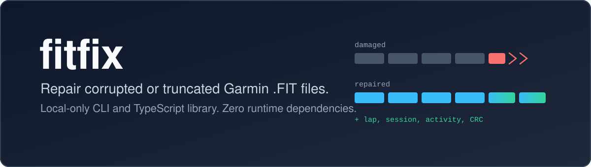
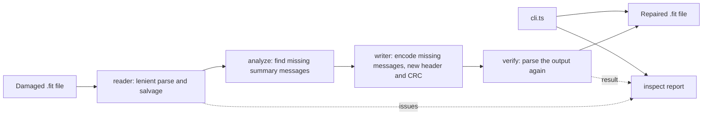

<div align="center">



[](https://www.npmjs.com/package/fitfix)
[](https://www.npmjs.com/package/fitfix)
[](LICENSE)
[](package.json)
[](tsconfig.json)
[](package.json)
[](#limitations)

[Why](#why) | [Features](#features) | [Demo](#demo) | [Architecture](#architecture) | [Limitations](#limitations) | [Quick start](#quick-start) | [Usage](#usage) | [Testing](#testing) | [Roadmap](#roadmap) | [License](#license)

</div>

**fitfix** repairs the structure of corrupted or truncated Garmin `.FIT` activity files on your own machine: header, data size, CRCs, cut-off records, and missing lap, session and activity messages. It is a command-line tool and a TypeScript library.

Repaired files are validated with an independent open-source decoder ([`fit-file-parser`](https://github.com/jimmykane/fit-parser) 6.2.7, strict mode) and with fitfix's own decoder, see [Testing](#testing). **No file recorded by a real device has been tested**, and nothing has been uploaded to Garmin Connect, Strava or any other service, so acceptance by those importers has not been verified.

## Why

A watch or bike computer writes the summary of an activity (the last lap, the session and the activity message) only when you press stop and save. If the battery dies, the firmware crashes or the file is cut during a sync, you get a file that:

- ends in the middle of a message,
- has a header whose data size and CRC no longer match the content,
- has no `session` or `activity` message, or a last lap that was never closed.

Uploaders reject such files ("file could not be processed", "no activity found", or a silent failure). The data is usually all there; only the structure is broken. fitfix repairs the structure and keeps your records.

## Features

Every item below is exercised by the automated test suite (see [Testing](#testing)).

- **Local only.** No network calls, no upload, no telemetry, no AI. Your activity never leaves your computer.
- **Never touches the original.** `repair` always writes a new file, and refuses an output path that is the input itself, a symlink to it or a hard link to it.
- **Conservative with your data.** Every record that decodes cleanly, including laps, events and developer fields, is copied byte for byte. fitfix removes only bytes it cannot decode (always listed in the report) and adds only messages that are missing.
- **Idempotent.** A healthy file is returned byte for byte unchanged, and repairing a repaired file is a no-op.
- **Zero runtime dependencies.** The FIT decoder, encoder and CRC are implemented from the public protocol description. No vendor SDK is involved.
- **Diagnose first.** `inspect` lists every problem with a code and an explanation; `--json` gives machine-readable output.
- **Self-verifying.** After writing, fitfix parses its own output again and reports whether it is structurally valid.

### What it fixes

| Damage | What fitfix does |
| --- | --- |
| Invalid header size byte | Detects where the data really starts (12 or 14) and rebuilds the header. |
| Damaged `.FIT` signature | Rebuilds the header if the data after it is recognizable FIT. |
| Wrong header CRC | Recomputes it. |
| Wrong data size in the header (zero, too large, too small) | Finds the real end of the data and writes the right size. |
| Wrong or missing file CRC | Recomputes it. |
| File cut in the middle of a message | Drops the incomplete final message, keeps everything before it. |
| Unreadable bytes in the middle | Skips them, resumes at the next strongly plausible record boundary, and reports every skipped byte range. |
| Junk after the file CRC | Drops it. |
| Chained FIT files (several files back to back) | Keeps every member and repairs each one separately. |
| No `file_id` | Adds one (type activity, manufacturer "development") only when the content shows an activity. Otherwise it reports the problem and adds nothing. |
| Last lap never closed | Adds a final lap covering the records after the last written lap. |
| No `lap` at all | Adds one lap covering the whole activity. |
| Timer never stopped | Adds a timer `stop_all` event. |
| No `session` | Adds one computed from the records. |
| No `activity` | Adds one. |

Synthesized laps and sessions contain start time, elapsed and timer time (timer pauses are subtracted), distance (from the record distance field, or from GPS positions), average and maximum speed, heart rate, cadence and power, ascent and descent, start and end positions, and the sport taken from the existing laps or `sport` message.

## Demo

This is real output, copied from an actual run. The input is a synthetic file generated by [`scripts/make-demo-fit.mjs`](scripts/make-demo-fit.mjs): 1,800 one-second records, two closed laps, and no summary, cut in the middle of the last message. It is not a recording from a device.

```console
$ fitfix inspect ride.fit
ride.fit (45,219 bytes)

Header     14 bytes, protocol 2.0, profile 21.32, signature OK, header CRC valid
Data       declared 45,212 bytes, readable 45,187 bytes
File CRC   MISSING
Messages   1,804 data, 5 definitions
           record 1,799, lap 2, file_id 1, device_info 1, event 1
Activity   2021-09-08 01:46:40 UTC -> 2021-09-08 02:16:38 UTC, 0h 29m 58s, 5.39 km, cycling
Summary    2 lap(s), 0 session(s), 0 activity message(s)

Findings (5)
  ERROR   truncated_message: The file ends in the middle of a message: 18 byte(s) at offset 45201 cannot be decoded and will be dropped.
  ERROR   data_size_mismatch: Header declares 45212 data bytes but 45187 readable bytes were found.
  ERROR   records_after_last_lap: 599 record(s) come after the last lap: the final lap was never closed.
  ERROR   missing_session: No session message: Garmin Connect and Strava need one to import an activity.
  ERROR   missing_activity: No activity message at the end of the file.

A repair would add:
  + lap (final lap was not closed)
  + event (timer was never stopped)
  + session (no session message)
  + activity (no activity message)

Verdict: damaged. Try: fitfix repair "ride.fit" -o fixed.fit

$ fitfix repair ride.fit
Repaired ride.fit
  - Added a lap message (final lap was not closed).
  - Added an event message (timer was never stopped).
  - Added a session message (no session message).
  - Added an activity message (no activity message).
  - Dropped 18 byte(s) of an incomplete final message.
  - Set header data size to 45539 bytes (was 45212).
  - Recomputed the header CRC and file CRC.
Size: 45,219 -> 45,555 bytes
Verification: the output re-parses cleanly (valid header, data size and CRCs).
Wrote ride-fixed.fit. The original file was not modified.

$ fitfix inspect ride-fixed.fit
ride-fixed.fit (45,555 bytes)

Header     14 bytes, protocol 2.0, profile 21.32, signature OK, header CRC valid
Data       declared 45,539 bytes, readable 45,539 bytes
File CRC   valid (0xA666)
Messages   1,808 data, 9 definitions
           record 1,799, lap 3, event 2, file_id 1, device_info 1, session 1, activity 1
Activity   2021-09-08 01:46:40 UTC -> 2021-09-08 02:16:38 UTC, 0h 29m 58s, 5.39 km, cycling
Summary    3 lap(s), 1 session(s), 1 activity message(s)

No problems found.

Verdict: no structural damage found.
```

## Architecture



A FIT file is a 12- or 14-byte header, a stream of records, and a 2-byte CRC. Each record starts with a one-byte header that says whether it is a *definition* (the layout of a message type) or a *data* message that uses a previously defined layout. Compressed-timestamp headers store a 5-bit time offset instead of a full timestamp.

1. **Header.** fitfix reads the header leniently. If the size byte is wrong, it checks whether a valid definition message starts at byte 14 or 12.
2. **Finding the data boundary.** It tries, in order: the size declared in the header, "whole file minus a 2-byte CRC", and "whole file without CRC". A candidate counts only if the stream parses cleanly to exactly that boundary. A matching CRC ranks a candidate first.
3. **Salvage.** If no boundary parses cleanly, it parses record by record. An incomplete final message is dropped. On unreadable bytes it scans forward for the next offset that starts with a strictly valid definition or a timestamped data message, followed by 8 records that decode with consistent timestamps. Every skipped range is reported. If another FIT header follows a member's CRC, the input is treated as a chain and each member is handled on its own.
4. **Analysis.** Data messages are decoded (both byte orders, all base types, invalid-value markers, compressed timestamps) to find which summary messages are missing and to compute their values from the records and timer events.
5. **Rewrite.** All readable records are copied verbatim, in order. Missing messages are encoded with fresh definitions and appended (or, for `file_id`, prepended). A new header with the correct data size and header CRC, and a new file CRC, are written.
6. **Verification.** The output is parsed again with the same code and the result is reported.

The CRC is the FIT CRC-16 (identical to CRC-16/ARC).

| Source file | Role |
| --- | --- |
| `src/reader.ts` | Lenient FIT parser with salvage and resynchronization |
| `src/analyze.ts` | Statistics and missing-message detection |
| `src/repair.ts` | `inspect` and `repair` orchestration |
| `src/writer.ts` | FIT encoder (`FitBuilder`, `assembleFitFile`) |
| `src/crc.ts`, `src/profile.ts` | CRC-16 and the subset of the FIT profile used |
| `src/format.ts`, `src/cli.ts` | Human-readable reports and the command-line interface |

## Limitations

fitfix is early software. Please read this before trusting it with the only copy of an activity (it never overwrites the original, but keep your backup anyway).

- **Not yet validated against a corpus of real broken files.** The test suite builds valid files in code, then damages them in many ways (header, sizes, CRCs, truncation at dozens of offsets, injected and overwritten bytes, 300 randomized corruptions), and checks repaired files with an independent decoder. Real devices fail in ways these fixtures may not cover. Reports with sample files (anonymized) are very welcome.
- **Validated only with an independent decoder.** Repaired files are accepted by `fit-file-parser` in strict mode. No file recorded by a real device was used.
- **No Garmin Connect or Strava import was tested.** Those importers are closed, may apply stricter or different rules, and change over time.
- Both fitfix and the independent decoder follow the public protocol, so a misreading of the protocol shared by both would not be caught.
- Values inside a damaged record are not checked: a flipped bit in a heart-rate value stays a wrong heart-rate value. fitfix only repairs structure.
- Out-of-order or nonsensical timestamps are **reported but not fixed**.
- Synthesized summaries do not include calories, training effect, zones, or other values that only the device can compute. Ascent and descent use a simple 1 m dead-band and may differ from the device's numbers.
- Resynchronization after garbage is heuristic: the point where reading resumes is a guess that rejects most false boundaries but can pick a wrong one in heavily damaged files. It deliberately drops valid messages without timestamps (for example `hrv`) right after the damaged area. Check the result.
- Chained FIT files are split only at a member boundary that follows a file CRC. If a member other than the last has a wrong data size or was cut short, the following member may be read as part of it.
- If the beginning of the file is lost (including the definition messages), data messages that depend on those definitions cannot be decoded and are dropped.
- Course, workout, and monitoring files are only repaired at the byte level; summary messages are added only to activity files.
- The whole file is held in memory several times. This is fine for activity files (a few megabytes); fitfix is not designed for files of hundreds of megabytes.
- No browser version yet.

## Quick start

Requires Node.js 22 or newer (on Windows PowerShell use `npm.cmd` instead of `npm`).

Install from npm:

```sh
npm install -g fitfix
fitfix --version
fitfix inspect ride.fit
```

Or build from source and try it on a synthetic broken file:

```sh
git clone https://github.com/Emincanozen/fitfix.git
cd fitfix
npm install
npm run build
npm test                                   # also compiles the fixture helpers used below
node scripts/make-demo-fit.mjs ride.fit    # writes a synthetic, truncated activity file
node dist/cli.js inspect ride.fit
node dist/cli.js repair ride.fit
```

From source, `npm link` makes the `fitfix` command available globally.

## Usage

```sh
fitfix inspect ride.fit                 # diagnose; add --json for machine-readable output
fitfix repair ride.fit -o ride-fixed.fit
fitfix repair ride.fit --dry-run        # show the plan, write nothing
fitfix repair ride.fit                  # writes ride-fixed.fit next to the input
```

| Option | Meaning |
| --- | --- |
| `-o, --output <file>` | Output path. Default: `<name>-fixed.fit` next to the input. |
| `--dry-run` | Print what would be done; write nothing. |
| `--force` | Overwrite the output file if it exists (never the input). |
| `--no-synthesize` | Only fix low-level damage; do not add missing lap/session/activity messages. |
| `--json` | Machine-readable result. |

Exit codes: `0` healthy or repaired and verified, `1` problems found (`inspect`) or the output still has errors (`repair`), `2` usage error, unreadable file, or not a FIT file.

### Library

```ts
import { readFileSync, writeFileSync } from "node:fs";
import { inspect, repair } from "./dist/index.js"; // or "fitfix" once installed as a package

const bytes = new Uint8Array(readFileSync("ride.fit"));
const report = inspect(bytes);          // { healthy, issues, stats, ... }
const result = repair(bytes);           // { changed, output, actions, before, after }
if (result.after.healthy) writeFileSync("ride-fixed.fit", result.output);
```

Lower-level pieces are exported too: `parseFit`, `fitCrc`, `FitBuilder`, `assembleFitFile`.

## Testing

```sh
npm run typecheck
npm test
```

Last run on this tree: typecheck clean, build clean, **82 tests in 22 suites, 82 passed, 0 failed** (about 8 seconds, Node.js 22). Tests use `node:test` and generate every fixture in code; there are no binary fixtures in the repository.

Fixtures and checks would share fitfix's own codec, so the suite also decodes fitfix output with an independent decoder, [`fit-file-parser`](https://github.com/jimmykane/fit-parser) 6.2.7 (MIT, dev dependency), in its strictest mode (`force: false, strict: true`: header CRC, file CRC, complete records, valid definitions, no trailing bytes). `test/independent-decoder.test.ts` checks that:

- that decoder rejects the damaged inputs (so it really validates);
- every repaired fixture (many kinds of damage, plus a chain of two files) decodes without error, with the same number of records fitfix kept;
- synthesized `file_id`, laps, session, activity and timer-stop messages are read back with the expected type, times, timestamps, distance, sport and lap count;
- a healthy file passes through byte for byte and decodes identically before and after.

This cross-check found one real defect (an average speed above the maximum speed when records were logged while the timer was stopped), now fixed. A randomized corruption test (300 iterations) checks that fitfix never crashes and always produces a structurally valid file.

What is **not** tested: files recorded by a real device, and import into Garmin Connect, Strava or any other service.

CI (`.github/workflows/ci.yml`) runs typecheck, build, tests and a CLI smoke test on Ubuntu, Windows and macOS with Node.js 22 and 24. The workflow is defined in the repository; no run results are claimed here.

## Roadmap

- Validate against a corpus of real, anonymized broken files from different devices.
- Check acceptance by real importers (Garmin Connect, Strava) and document the results.
- Report and optionally fix out-of-order timestamps.
- Publish to npm.
- A browser build (the core library has no Node-specific dependencies).

## Contributing

Issues and pull requests are welcome: see [CONTRIBUTING.md](CONTRIBUTING.md). Security problems go through [SECURITY.md](SECURITY.md). Changes are listed in [CHANGELOG.md](CHANGELOG.md).

## License

MIT, see [LICENSE](LICENSE).

FIT is a protocol published by Garmin. This project is independent and is not affiliated with or endorsed by Garmin or Strava.
